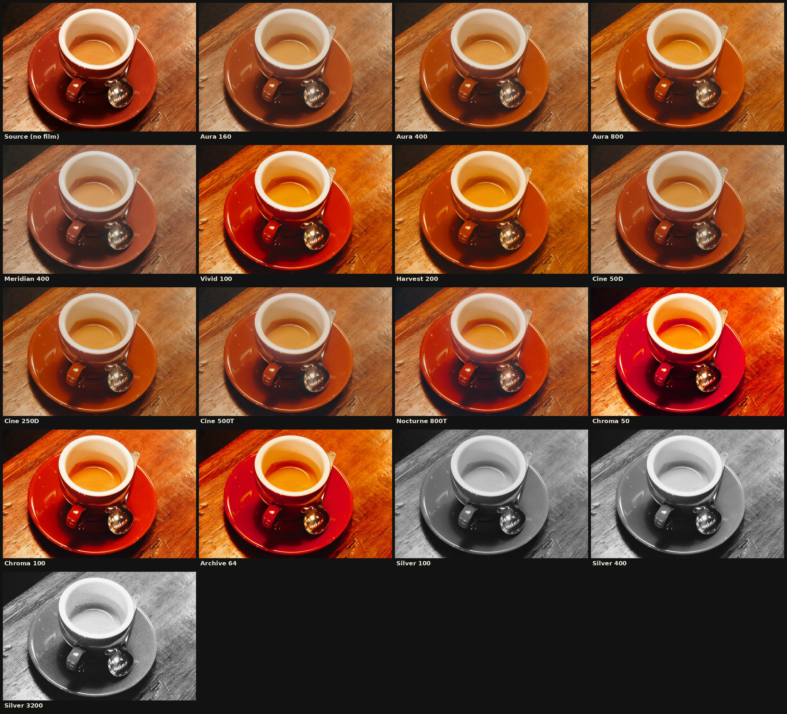

# Kamera

A film camera for Android. Load a roll, compose through a viewfinder that already shows the finished
picture, then shoot stills or motion. Every negative stays editable, so any frame can be developed
again on a different stock later.



## Install

**[Download Kamera.apk](https://github.com/terpenesalad/Kamera/releases/latest/download/Kamera.apk)** on your phone and open it. Allow installs from your browser if Android asks, then tap **Install**.

The same file is kept up to date at [`Kamera.apk`](Kamera.apk) in this repository. Kamera needs Android 11 or newer and OpenGL ES 3.0. New versions install over the old one and keep your library.

## What's inside

**Twenty-four looks**

| Family | Look | Leans towards |
| --- | --- | --- |
| Colour negative | Aura 160, Aura 400, Aura 800 | Portra 160 / 400 / 800 |
| | Meridian 400 | Pro 400H |
| | Vivid 100 | Ektar 100 |
| | Harvest 200 | Gold 200 |
| Motion picture | Cine 50D, Cine 250D, Cine 500T | Vision3 50D / 250D / 500T |
| | Nocturne 800T | CineStill 800T |
| Slide | Chroma 50, Chroma 100 | Velvia 50, Provia 100F |
| | Archive 64 | Kodachrome 64 |
| Classic simulations | Documentary, Street Neg, Nostalgia | Classic Chrome, Classic Negative, Nostalgic Neg |
| | Soft Slide, Flat Cine, True Neg | Astia, Eterna, Reala Ace |
| Black & white | Silver 100, Silver 400, Silver 3200 | Acros 100, Tri-X 400, P3200 |
| | Silver 100 Ye, Silver 100 R | Acros with yellow and red filters |

These are original interpretations built on a physical film model. They are not measured profiles or
exact copies, and Kamera is not affiliated with the films and simulations it references.

**How the film is simulated:** each emulsion's layers respond to light by wavelength, form cyan, magenta and
yellow dyes, and (for negatives) expose a simulated print paper. Grain follows the RMS granularity scale film
makers publish, scales with density, and is shaped by the film's response curve. Halation, bloom and the
softer acutance of film are simulated too.

**Camera:** manual shutter, ISO, focus, exposure compensation and white balance (presets, Kelvin, or
balanced to the loaded film) · a 35 mm view on wide phone lenses · push and pull development · 3:2, 4:3, 1:1,
5:4, 16:9 and 65:24 formats · 1080p and 4K video at 24 to 60 fps in 16:9, 1.85 and 2.39 · live histogram,
zebras, focus peaking, grid and level · volume-key shutter.

**Darkroom:** re-develop on any look · exposure, contrast, highlights, shadows, whites, blacks, fade ·
temperature, tint, saturation, vibrance, seven-band colour mixer, split toning · grain, halation, bloom,
vignette, clarity, sharpening · crop, straighten, rotate, mirror · video trim and grade · import from your
gallery.

**Filter holder:** load up to three square filters at once, in the style of the Cokin system, and see them
live in the viewfinder:

- *Colour:* 81A, 81B, 81C and 81EF warming, 85B amber, 82A and 82B cooling, 80A blue, sepia, a circular
  polariser, and yellow, orange, red and green filters that change black-and-white tones as they do on real film
- *Graduated:* grey ND2, ND4 and ND8 (hard and soft), tobacco, blue, sunset, mauve and emerald, with
  adjustable position, softness and tilt
- *Effect:* diffusers, mist, fog, centre spot, pastel and 4, 6 and 8-point stars

Filters stay with each photo's recipe, so you can add, change or remove them later in the darkroom.

**Always dark:** every screen stays dark, even if your phone is set to light mode.

## Privacy

- Saved photos contain only the picture: no location, date, camera model or settings.
- Saved videos have their recording dates and device tags removed.
- File names are random, so they don't reveal when something was taken.
- Kamera has no location or internet permission, so it can't read your position or send anything anywhere.

## How the viewfinder matches the final picture

One GLSL program (`app/src/main/assets/shaders/film.frag`) renders the viewfinder, the video encoder, the
photo developer and the editor. On top of that:

- **Same sensor path.** Stills are captured as YUV from the same ISP path as the preview, with exposure and
  white balance locked to what was on screen. Vendor still processing never runs.
- **Same colour.** Each stock is baked into one 3D LUT that every output samples.
- **Resolution-independent grain and glow.** Grain has a physical size on a virtual 35 mm frame, and halation
  runs in fixed-resolution buffers, so a 1080p preview and a 12 MP photo agree at the same viewing size.
- **Same framing.** The viewfinder crops to the exact format that will be saved.

Flash is the one exception: a viewfinder can't preview light that hasn't fired yet.

## Project layout

```
core/    Pure Kotlin film science: colour model, stocks, LUT baking, grain, geometry, recipes, tests
app/     Android app: Camera2, OpenGL ES 3 engine, recording, library, interface
tools/   Headless GL bench that runs the app's real shaders for look and match testing
docs/    Architecture notes and the contact sheet
```

The app has no third-party runtime dependencies. See [docs/ARCHITECTURE.md](docs/ARCHITECTURE.md).

## Build

Pushes to `main` are tested and built by GitHub Actions, which publishes an installable release.

To build locally you need JDK 17 and the Android SDK (API 36):

```sh
./gradlew :core:test :app:assembleRelease
```

## Signing

Release builds are signed with `app/kamera-sideload.keystore`, whose password is in `app/build.gradle.kts`.
Android only installs updates signed with the same key, so a stable key keeps updates working. This key is
public because this repository is, so it proves nothing about who built an APK. **Before distributing
Kamera to anyone else, replace it** with a private key supplied through the `KAMERA_KEYSTORE_FILE`,
`KAMERA_KEYSTORE_PASSWORD`, `KAMERA_KEY_ALIAS` and `KAMERA_KEY_PASSWORD` environment variables.
